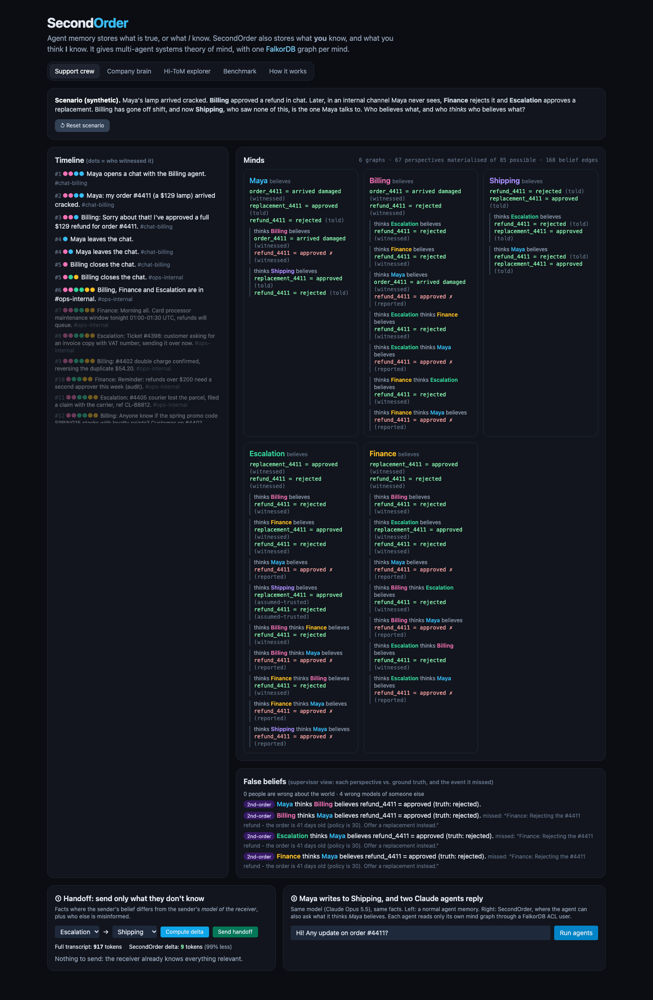
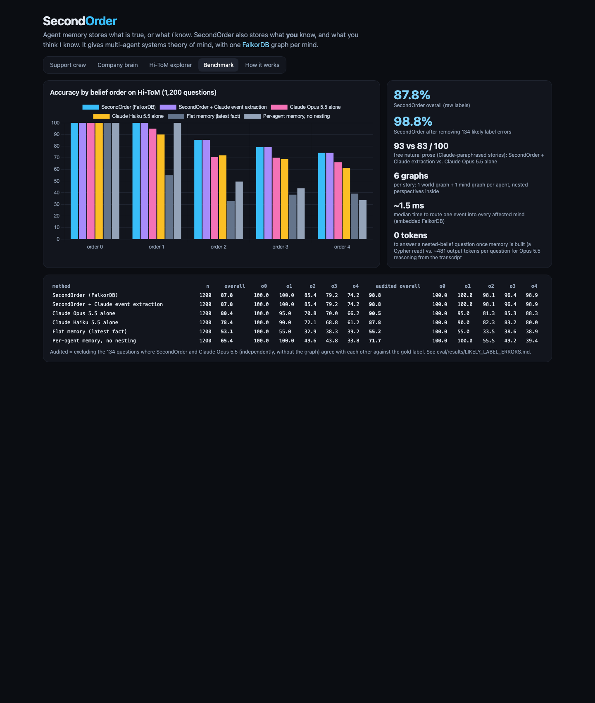
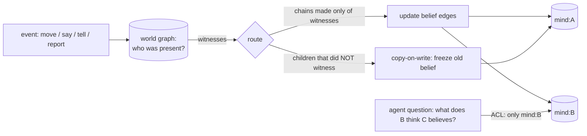

# SecondOrder: theory-of-mind memory for AI agents, on FalkorDB

> Agent memory stores what is true, or what *I* know. **SecondOrder also stores what *you* know, and what you think *I* know.**

Multi-agent systems fail at the seams. One agent promises a customer a refund; another rejects it in a channel the first never sees; a third
picks up the conversation with no idea that the customer still believes the promise. Every memory system today (vector stores, knowledge
graphs, temporal graphs) records *facts*. None records **who knows which facts, and who thinks who knows them**, which is exactly the
context a handoff, a correction or an announcement needs.

SecondOrder gives agents **theory of mind** as a memory layer. Each agent has its own FalkorDB graph holding what it believes and nested
perspectives for what it thinks others believe (and what it thinks they think others believe, up to depth 4). Events update only the minds
of the agents who witnessed them, so the graph knows who is out of date, who has a wrong model of whom, and the smallest message that fixes
it.

**Tracks:** **Track 02: Agent Memory and Coordination** (primary) · **Track 03: Company Brain**

| | |
|---|---|
| Live demo | **TODO: deployment URL** · or deploy your own: [](https://render.com/deploy?repo=https://github.com/TusharTechs/secondorder) |
| Demo video | [`docs/video/demo.mp4`](docs/video/demo.mp4) (2:26, captioned) |
| Blog post | [`docs/BLOG.md`](docs/BLOG.md) |
| Run locally | `pip install -r requirements.txt && uvicorn server.app:app` (no Docker, no API key needed) |



---

## What it does

| Capability | Tool (MCP + API) | What it answers |
|---|---|---|
| Nested beliefs | `believes(chain, entity)` | "What does Shipping think Maya believes about the refund?" (any depth, with provenance) |
| Stale-belief detection | `false_beliefs(depth)` | Everyone acting on outdated info (depth 1), and every *wrong model of someone else* (depth 2), with the exact event each one missed |
| Minimal handoffs | `handoff_delta(sender, receiver)` | Only the facts the sender's model of the receiver lacks, including "Maya still believes X". Demo: **806 → 48 tokens** |
| Out-of-the-loop | `who_knows(entity)` | Who is up to date about a decision, and who isn't |
| Common ground | `common_ground(a, b)` | What A and B both know *and know the other knows* (Clark & Brennan) |
| Explanations | `explain(chain, entity)` | Source event, its witnesses, perspective inheritance, who-told-whom path (`algo.SPpaths`) |
| Announcement planning | `plan_announcements(entity, speaker)` | Private messages vs. one announcement, **simulated on `GRAPH.COPY` forks**: 4 DMs leave 28 second-order false beliefs, 1 announcement leaves 0 |
| Time travel | `believes(..., at=step)` | What did this perspective believe at step N |
| Access control | per-agent FalkorDB ACL user | An agent can read **only its own mind graph**. Reading another agent's mind returns `NOPERM` |

### Demo 1: Support crew (Track 2)
Maya's lamp arrived cracked. **Billing** approves a refund in chat, then mentions in `#ops-internal` that it told Maya. **Finance** rejects
the refund (order too old) and **Escalation** approves a replacement, after Billing went off shift. Now Maya writes to **Shipping**, who saw
none of it.

1. `false_beliefs` shows Maya believes the refund is approved and pinpoints the message she missed. It also shows that Billing, Finance and Escalation
   all *know* Maya believes it (a second-order belief they got from Billing's report).
2. `handoff_delta(Escalation → Shipping)` returns 3 facts (48 tokens) instead of the 806-token channel transcript: refund rejected,
   replacement approved, and **"Maya still believes the refund is approved"**.
3. Two Claude Opus 5.5 agents answer Maya's "Any update on order #4411?" with the same facts. The flat-memory agent states the news.
   The SecondOrder agent calls `who_is_misinformed`, learns what Maya was told, and opens with *"I need to correct something first… I'm
   sorry if you heard otherwise."* After human approval, its reply is written back as a chat message and Maya's false belief disappears.
4. Shipping's agent connects as ACL user `agent_shipping`, which can only run `GRAPH.RO_QUERY` on `so:*:mind:Shipping`. Trying to
   read Escalation's mind fails with `No permissions to access a key`.

### Demo 2: Company brain, "who's out of the loop?" (Track 3)
A deploy freeze and launch date are set at all-hands, then changed in a thread only 3 of 7 people saw. Dara mentions Eli's team is rushing
a migration before the *old* freeze. `who_knows`, `false_beliefs` (incl. "Dara thinks Eli believes…") and `plan_announcements` show that
private DMs to the four stale people fix their beliefs but leave **28** wrong second-order beliefs, while one announcement leaves **0**.

### Demo 3: Hi-ToM explorer
Pick any of the 1,200 Hi-ToM questions. Watch SecondOrder build the minds in FalkorDB, see the belief of every nested perspective at every
step, the explanation, and what Claude answered without the graph.

---

## Results (Hi-ToM benchmark, 1,200 questions, orders 0–4)

[Hi-ToM](https://github.com/ying-hui-he/Hi-ToM_dataset) (He et al., EMNLP 2023, Apache-2.0) tests higher-order theory of mind: agents
enter and leave rooms, move objects, lie publicly and whisper privately. *"Where does Charlotte think Jack thinks Hannah thinks William
thinks the carrot is?"*

| Method | n | overall | order 0 | 1 | 2 | 3 | 4 | audited overall¹ |
|---|---|---|---|---|---|---|---|---|
| **SecondOrder (FalkorDB)** | 1200 | **87.8** | 100.0 | 100.0 | 85.4 | 79.2 | 74.2 | **98.8** |
| **SecondOrder + Claude event extraction**² | 1200 | **87.8** | 100.0 | 100.0 | 85.4 | 79.2 | 74.2 | **98.8** |
| Claude Opus 5.5 alone (chain of thought) | 1200 | 80.4 | 100.0 | 95.0 | 70.8 | 70.0 | 66.2 | 90.5 |
| Claude Haiku 5.5 alone | 1200 | 78.4 | 100.0 | 90.0 | 72.1 | 68.8 | 61.2 | 87.8 |
| Flat memory (stores the latest fact) | 1200 | 53.1 | 100.0 | 55.0 | 32.9 | 38.3 | 39.2 | 55.2 |
| Per-agent memory, no nesting | 1200 | 65.4 | 100.0 | 100.0 | 49.6 | 43.8 | 33.8 | 71.7 |

**Free text (no templates):** Claude rewrote 100 stratified stories as varied natural prose. SecondOrder with Claude extraction scored **93/100**, and
Claude Opus 5.5 reading the same prose alone scored **83/100** (`eval/run_paraphrase.py`).



- **Ablations:** both cheaper memory designs collapse at order ≥ 2. A flat memory (even one that knows the truth) answers "where does A think B thinks…" with
  the current fact. Per-agent memory without nesting can't separate A's belief from A's model of B. **The nesting is the thing.**
- **Cost:** once memory is built, answering is a Cypher read (0 LLM tokens). Opus 5.5 spends about 480 output tokens per question re-reading the
  transcript. Routing one event into every affected mind takes a median **~1.5 ms** on embedded FalkorDB.
- ¹ **Benchmark audit.** On 134 questions, SecondOrder (which follows the benchmark's stated rules) and Claude Opus 5.5 (independently, no graph)
  give the *same* answer, and it differs from the gold label. They are concentrated in orders 2–4. The generator's history has a commit "fix
  permutation bug" (`9117f35d`) that changed how nested beliefs are written. We report raw and audited numbers side by side and list every
  question in [`eval/results/LIKELY_LABEL_ERRORS.md`](eval/results/LIKELY_LABEL_ERRORS.md). Nothing is silently dropped. Audited =
  the 1,066 remaining questions.
- ² Claude Opus 5.5 turns the raw story text into events (`secondorder/llm.py`, structured outputs); the graph does all belief reasoning.
  It matches the deterministic parser exactly, so the benchmark score does not depend on the template parser.

Reproduce: `python -m eval.run_graph`, `python -m eval.run_llm answer --model claude-opus-5-5`, `python -m eval.run_llm extract`,
`python -m eval.run_graph --events eval/results/events_claude-opus-5-5.json --name graph_llm`, `python -m eval.run_paraphrase`,
`python eval/summarise.py`.

---

## Graph data model

```
one FalkorDB instance, many graphs
├── so:<sid>:world                       ground truth + perception
│     (:Agent)-[:IN {since, chapter}]->(:Room)          (:Agent)-[:EXITED {t, chapter}]->(:Room)
│     (:Agent)-[:WITNESSED]->(:Event {seq, kind, text, room})-[:ABOUT]->(:Entity)
│     (:Agent)-[:PERFORMED]->(:Event)     (:Entity)-[:IS {t}]->(:Value)-[:LOCATED_IN]->(:Room)
│     (:Agent)-[:TOLD {t, entity, value, public, trusted}]->(:Agent)
├── so:<sid>:mind:Maya                   everything Maya believes
├── so:<sid>:mind:Shipping
│     (:Perspective {chain:'Shipping'})                 what Shipping believes
│     (:Perspective {chain:'Shipping>Maya'})            what Shipping thinks Maya believes
│     (:Perspective {chain:'Shipping>Maya>Billing'})    ... up to depth 4
│     (child:Perspective)-[:INHERITS]->(parent:Perspective)
│     (:Perspective)-[:BELIEVES {entity, active, t, until, via, src, event}]->(:Value)
└── ...
```



**Key ideas**
- **One graph per agent = the security boundary.** FalkorDB hosts thousands of isolated graphs in one instance. A Redis/FalkorDB ACL user per
  agent is limited to `GRAPH.RO_QUERY` on `~so:*:mind:<agent>`, so agents get theory of mind, not omniscience.
- **Perspectives store only divergence.** A nested perspective holds a belief edge only where it differs from its parent. Reading is one
  variable-length `INHERITS` walk. Writing uses **copy-on-write per belief edge**: before an event updates a perspective, its children that
  did not witness the event get the old value frozen (`via: 'retained'`).
- **Perception routing is the core rule.** An event updates `mind:A>B>C` only if A, B and C all witnessed it (A saw B and C there). Private
  tells, public claims and reports ("I told Maya her refund is approved") each have their own routing. The Hi-ToM trust rule ("believe a
  speaker who left the room after you") is a Cypher predicate over `EXITED` edges.
- **Nothing is deleted.** Superseded beliefs get `active:false, until:t`, so you can time-travel (`resolve_at`).
- **`GRAPH.COPY` for what-ifs.** `plan_announcements` forks every graph of a scenario, simulates each plan, and measures the false beliefs
  left over.

**All 26 Cypher queries** the product runs are listed with explanations in [`docs/CYPHER.md`](docs/CYPHER.md). Graph algorithms used:
`algo.SPpaths` (who-told-whom information path), variable-length path traversal for belief inheritance, `GRAPH.COPY` for simulation forks.
FalkorDB features used: multigraph (one graph per agent plus a world graph), ACL key patterns, `GRAPH.RO_QUERY`, `GRAPH.COPY`,
parameterised Cypher.

The core read:
```cypher
MATCH (p:Perspective) WHERE p.chain IN $prefixes
WITH p ORDER BY p.depth DESC LIMIT 1
MATCH path = (p)-[:INHERITS*0..6]->(q:Perspective)-[b:BELIEVES {entity: $entity, active: true}]->(v:Value)
RETURN v.name, b.via, b.t, b.event, b.src, q.chain, length(path)
ORDER BY length(path) ASC LIMIT 1
```

---

## Use it from any agent (MCP)

```bash
# supervisor mode: read/write tools over a scenario
claude mcp add secondorder -- /path/to/.venv/bin/python /path/to/mcp_server.py
# agent mode: read-only, ACL-scoped to one agent's own mind
claude mcp add secondorder-shipping -e SO_AGENT=Shipping -- /path/to/.venv/bin/python /path/to/mcp_server.py
```
Supervisor tools: `believes`, `false_beliefs`, `handoff_delta`, `who_knows`, `common_ground`, `explain`, `plan_announcements`, `record`
(write events: enter / exit / state / say / tell / report). Agent tools: `my_beliefs`, `what_does_person_believe`, `nested_belief`,
`who_is_misinformed`.

---

## Setup

**Fastest (embedded FalkorDB, no Docker):**
```bash
python3.12 -m venv .venv && .venv/bin/pip install -r requirements.txt
.venv/bin/uvicorn server.app:app --port 8000          # http://localhost:8000
```
**With a FalkorDB server (and FalkorDB Browser on :3000 to inspect the mind graphs):**
```bash
docker compose up --build                              # app on :8000, FalkorDB on :6379, Browser on :3000
```
Set `FALKORDB_HOST/PORT/USERNAME/PASSWORD` to use FalkorDB Cloud. `ANTHROPIC_API_KEY` is optional: it enables the live Claude agents and
the LLM evals. Without it the live-agent panel replays a recorded run. Python 3.12+.

```
secondorder/engine.py      graph model, perception routing, copy-on-write, resolution (all Cypher in dict Q)
secondorder/tools.py       false_beliefs, handoff_delta, who_knows, common_ground, explain, plan_announcements
secondorder/agent_view.py  ACL-scoped read-only view of one agent's own mind
secondorder/agent.py       live Claude agent (flat vs SecondOrder) with approval-gated write-back
secondorder/hitom.py       Hi-ToM adapter (parser + question -> perspective chain)
secondorder/llm.py         Claude: baselines + free-text event extraction (structured outputs)
secondorder/scenarios.py   synthetic support-crew and company scenarios
mcp_server.py              MCP server (supervisor and agent modes)
server/                    FastAPI + single-page UI
eval/                      benchmark runners, results, label audit
```

## Prior art and what's new
- **SymbolicToM** (Sclar et al., ACL 2023) tracks nested belief graphs inside an LLM prompting pipeline for reading comprehension. SecondOrder takes
  the idea out of the prompt and into a **persistent, database-native, multi-agent memory service**: per-agent graphs with ACLs,
  copy-on-write perspectives, provenance, time travel, and agent tools for handoffs, corrections and announcements.
- **Hi-ToM** (He et al., EMNLP 2023) is the benchmark and its generator. **MAST** ("Why Do Multi-Agent LLM Systems Fail?", Cemri et al., 2025) identifies
  inter-agent misalignment as a major failure category. **Common ground** (Clark & Brennan, 1991).
- Memory systems like Graphiti/Zep, Mem0, Cognee and Letta model facts, time and entities, not *who believes what about whom*.

## Honest limits
- Stories and scenarios are synthetic. The support and org demos are scripted to show the mechanism. Hi-ToM is templated, which is why we also
  test LLM extraction and free-prose paraphrases.
- Trust is rule-based (Hi-ToM exit order, or "credulous" for the demos). Real deployments need richer source-reliability models.
- `false_beliefs` with ground truth is a supervisor tool. Agents themselves only see their own mind (`who_is_misinformed`).
- The perspective count grows as n·(n-1)^(d-1) in the worst case; copy-on-write and lazy creation keep it small in practice, and depth 2
  is the useful product setting.

## Built with AI assistance (disclosure)
This project was built during the hackathon (Oct 18, 2026) with **Claude Code** as a coding assistant: research on competitors and prior art,
code generation, the evaluation harness and documentation drafts. The concept, design decisions and review are by the author, who can
explain every part of the graph model and queries. Claude models are also part of the product: Claude Opus 5.5 for event extraction and the
live agents, Opus/Haiku 5.5 as baselines.

## License
MIT. Hi-ToM data (`data/hitom.json`) © its authors, Apache-2.0.
