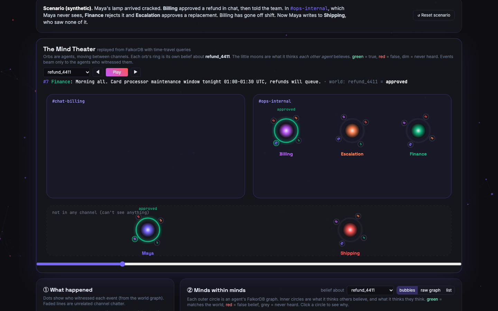
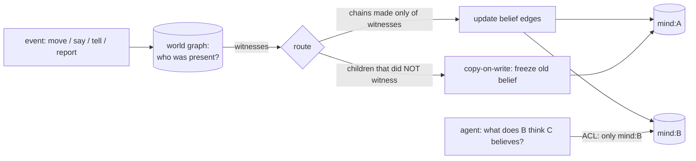

# SecondOrder: theory-of-mind memory for AI agents, on FalkorDB

[](https://github.com/TusharTechs/secondorder/actions/workflows/ci.yml)

> Agent memory stores what is true, or what *I* know. **SecondOrder also stores what *you* know, and what you think *I* know.**

Multi-agent systems fail at the seams. One agent promises a customer a refund; another rejects it in a channel the first never sees; a third
picks up the conversation with no idea the customer still believes the promise. Every memory system today (vector stores, knowledge graphs,
temporal graphs) records *facts*. None records **who knows which facts, and who thinks who knows them**, which is exactly the context a
handoff, a correction or an announcement needs.

SecondOrder gives agents **theory of mind** as a memory layer. Each agent has **its own FalkorDB graph** holding what it believes, plus nested
perspectives for what it thinks others believe (up to depth 4). Events update only the minds of agents who **witnessed** them, so the graph
knows who is out of date, who has a wrong model of whom, and the smallest message that fixes it. Each agent connects as its own FalkorDB ACL
user and can read **only its own mind**: theory of mind, not omniscience.

**Tracks:** **Track 02: Agent Memory and Coordination** (primary) · **Track 03: Company Brain**

| | |
|---|---|
| Live demo | **TODO: deployment URL** · or deploy your own: [](https://render.com/deploy?repo=https://github.com/TusharTechs/secondorder) |
| Demo video | [`docs/video/demo.mp4`](docs/video/demo.mp4) (captioned walkthrough) |
| Run locally (no Docker, no API key) | `pip install -r requirements.txt && uvicorn server.app:app` |


*The Mind Theater, replayed from FalkorDB with time-travel queries. Orbs are agents in their channels. Each orb's ring is its own belief, and its
moons are what it thinks each other agent believes (green = true, red = false). Events beam only to the agents who witnessed them.*

---

## Headline results

| | |
|---|---|
| **Hi-ToM, 1,200 questions up to 4th-order belief** | **100%** vs. the benchmark's own reference oracle (Claude Opus 5.5 alone: 91.0%, Haiku 5.5: 86.5%, flat memory: 50.0%) |
| …and vs. the released JSON labels | **87.8%** (Opus 80.4%, Haiku 78.4%). The 147 differences are questions where the released labels **contradict the benchmark's own published code** ([details](#a-finding-about-the-benchmark)) |
| Free prose (no templates), 100 stories | **100/100** with Claude event extraction vs. **89/100** for Opus alone (reference labels; 93 vs 83 on released labels) |
| **Agent task (20 cases, Claude judge)** | Correcting a customer's stale belief the agent never saw form: **SecondOrder 20/20 at 1,723 tokens** vs. flat memory **1/20**. A full transcript handoff also gets 20/20 but costs **8,218 tokens** with a longer channel history, and grows with it; SecondOrder's prompt doesn't |
| Handoff context | **806 → 48 tokens**: only what the receiver lacks, including *"Maya still believes the refund is approved"* |
| Multi-tenant scale | **10,200 graphs in one FalkorDB**: 2.9 ms p50 / 9 ms p99 per event, 0.21 ms nested read; flat as graphs are added |
| Announcements | 4 private DMs leave **28** wrong beliefs about each other; 1 announcement leaves **0** (simulated on `GRAPH.COPY` forks) |

---

## What it does

| Capability | Tool (MCP + API) | What it answers |
|---|---|---|
| Nested beliefs | `believes(chain, entity)` | "What does Shipping think Maya believes about the refund?" (any depth, with provenance) |
| Stale-belief detection | `false_beliefs(depth)` | Everyone acting on outdated info (depth 1), and every *wrong model of someone else* (depth 2), with the exact event each one missed |
| Minimal handoffs | `handoff_delta(sender, receiver)` | Only the facts the sender's model of the receiver lacks |
| Out-of-the-loop | `who_knows(entity)` | Who is up to date about a decision, and who isn't |
| Common ground | `common_ground(a, b)` | What A and B both know *and know the other knows* (Clark & Brennan) |
| Explanations | `explain(chain, entity)` | Source event, its witnesses, perspective inheritance, who-told-whom path (`algo.SPpaths`) |
| Announcement planning | `plan_announcements(entity, speaker)` | Private messages vs. one announcement, simulated on `GRAPH.COPY` forks of every graph |
| Time travel | `believes(..., at=step)` | What a perspective believed at step N (powers the Mind Theater) |
| Context for any LLM | `Memory.context_for(agent, talking_to)` | A compact block to prepend to any prompt: what I believe, what they believe, where we differ |
| Access control | per-agent FalkorDB ACL user | An agent can only `GRAPH.RO_QUERY` its own `so:*:mind:<agent>`; anything else returns `NOPERM` |

### The demo app
- **Mind Theater:** an animated replay of the scenario from FalkorDB (`resolve_at` time-travel queries). Agents move between channels, events
  beam to witnesses only, and belief rings and moons turn red when a belief goes stale.
- **Minds within minds:** a circle-packing view of each agent's graph and its nested perspectives (click any circle for the *why*), a **raw-graph**
  view of a real mind graph (Perspective nodes, `INHERITS`, `BELIEVES`), and a list view.
- **Handoff:** transcript vs. delta tokens, then write the handoff into memory.
- **Two live Claude agents** answer the customer with the same facts. The flat-memory agent states the news. The SecondOrder agent calls
  `who_is_misinformed`, sees what Maya was told, and opens with *"I need to correct something first…"*. After human approval, its reply is written
  back and Maya's false belief disappears. The ACL demo shows Shipping's `GRAPH.RO_QUERY` on Escalation's mind refused.
- **Live event composer:** type *"Escalation privately tells Billing the replacement was approved"*. Claude extracts perception events,
  FalkorDB routes them into exactly the minds that witnessed them, and the changed perspectives pulse.
- **Company brain:** a decision changed in a thread only 3 of 7 people saw. `who_knows`, second-order false beliefs ("Dara thinks Eli
  believes…") and the announcement planner.
- **Hi-ToM explorer:** any of the 1,200 questions, with the minds built live, each nested perspective's belief at every step, the reasoning read
  level by level from the graph, and Claude's answer without it.


---

## Results in detail

[Hi-ToM](https://github.com/ying-hui-he/Hi-ToM_dataset) (He et al., EMNLP 2023, Apache-2.0) tests higher-order theory of mind: agents
enter and leave rooms, move objects, lie publicly and whisper privately. *"Where does Charlotte think Jack thinks Hannah thinks William
thinks the carrot is?"* Every method is scored on **all 1,200 questions** against two label sets; nothing is excluded.

| Method | vs released labels | o0 | o1 | o2 | o3 | o4 | **vs Hi-ToM reference oracle** | o0 | o1 | o2 | o3 | o4 |
|---|---|---|---|---|---|---|---|---|---|---|---|---|
| **SecondOrder (FalkorDB)** | **87.8** | 100 | 100 | 85.4 | 79.2 | 74.2 | **100.0** | 100 | 100 | 100 | 100 | 100 |
| **SecondOrder + Claude event extraction** | **87.8** | 100 | 100 | 85.4 | 79.2 | 74.2 | **100.0** | 100 | 100 | 100 | 100 | 100 |
| Claude Opus 5.5 alone (chain of thought) | 80.4 | 100 | 95.0 | 70.8 | 70.0 | 66.2 | 91.0 | 100 | 95.0 | 82.9 | 86.2 | 90.8 |
| Claude Haiku 5.5 alone | 78.4 | 100 | 90.0 | 72.1 | 68.8 | 61.2 | 86.5 | 100 | 90.0 | 82.5 | 80.8 | 79.2 |
| Flat memory (stores the latest fact) | 53.1 | 100 | 55.0 | 32.9 | 38.3 | 39.2 | 50.0 | 100 | 55.0 | 30.8 | 34.2 | 30.0 |
| Per-agent memory, no nesting | 65.4 | 100 | 100 | 49.6 | 43.8 | 33.8 | 68.3 | 100 | 100 | 58.3 | 48.3 | 35.0 |

- **Ablations:** both cheaper memory designs collapse at order ≥ 2. A flat memory, even one that knows the truth, answers "where does A think B thinks…"
  with the current fact. Per-agent memory without nesting can't separate A's belief from A's model of B. **The nesting is the point.**
- **Extraction:** Claude Opus 5.5 turns raw story text into events (structured outputs) and the graph does all belief reasoning. It matches the
  template parser exactly, so the score doesn't depend on the parser. On 100 stories Claude rewrote as varied natural prose: 100/100 vs. 89/100
  for Opus alone.
- **Cost:** once memory is built, answering is a Cypher read (0 LLM tokens). Opus 5.5 spends about 480 output tokens per question re-reading the transcript.

### Agent task: correcting what the customer was told
[`eval/run_agents.py`](eval/run_agents.py) uses 20 synthetic support cases across 5 kinds of decision: refund, delivery date, discount, warranty, cancellation.
In each case:
- agent A tells the customer X in chat;
- X changes to Y in an internal channel the customer never sees;
- the case is handed off to agent B;
- the customer's next message ("Any update?") never restates X.

All agents are Claude Opus 5.5. A Claude judge checks whether the reply **explicitly corrects** the customer's outdated understanding.

| Agent B's memory | corrects (short history) | input tokens | corrects (8× longer history) | input tokens |
|---|---|---|---|---|
| flat (own facts after handoff) | 1/20 | 1,514 | 1/20 | 1,514 |
| full transcript handoff | 20/20 | 2,628 | 20/20 | **8,218** |
| SecondOrder tools (`who_is_misinformed`, …) | 19/20 | 2,095 | 20/20 | 2,095 |
| **SecondOrder context** (`context_for`, injected, read only from B's own mind) | **20/20** | **1,723** | **20/20** | **1,723** |

None of the agents asserted the outdated fact. The point is cost: a transcript gets the same answer by re-reading everything, so its cost grows
with history, while SecondOrder's context stays constant because the graph already knows *who believes what*. This eval also caught a real bug (Unicode names in
ACL-scoped queries), now fixed and covered by a test.

### A finding about the benchmark
We replayed every story through **Hi-ToM's own published belief-tracking code**: the authors' `Oracle` and action classes, vendored unmodified in
[`third_party/hitom`](third_party/hitom), driven by [`eval/reference_oracle.py`](eval/reference_oracle.py), with no FalkorDB and no LLM.
- It agrees with SecondOrder on **1,200 / 1,200** questions.
- It agrees with the released `Hi-ToM_data.json` labels on only **1,053 / 1,200**.

So 147 released labels (concentrated in orders 2–4) are inconsistent with the generator's own code. The repo history has a commit "fix permutation
bug" (`9117f35d`) that changed how nested beliefs are written, which may explain the drift. All 147 are listed with the released label, the
reference answer, SecondOrder's answer and Opus's answer in [`eval/results/LABEL_ERRORS.md`](eval/results/LABEL_ERRORS.md). Claude Opus 5.5,
independently and without the graph, sides with the reference code on 134 of them. We reported this to the authors:
[ying-hui-he/Hi-ToM_dataset#4](https://github.com/ying-hui-he/Hi-ToM_dataset/issues/4).

### Scale (one FalkorDB instance)
[`eval/scale.py`](eval/scale.py) runs on embedded FalkorDB 4.18 on a laptop.

**Multi-tenancy:** 1,700 isolated scenarios, each with 1 world graph and 5 mind graphs, for **10,200 graphs** in total.

| graphs | event p50 | event p99 | nested read p50 |
|---|---|---|---|
| 1,020 | 2.5 ms | 8.1 ms | 0.18 ms |
| 5,100 | 2.8 ms | 10.0 ms | 0.20 ms |
| 10,200 | 2.9 ms | 9.0 ms | 0.21 ms |

**Agents × depth:** the cost of one broadcast event, median.

| agents | depth | perspectives | with `Perspective(chain)` index | without index |
|---|---|---|---|---|
| 32 | 2 | 1,024 | 12.0 ms | 12.4 ms |
| 12 | 3 | 1,464 | 11.3 ms | 17.4 ms |
| 16 | 3 | 3,616 | 22.7 ms | 57.3 ms |

**Memory:** about 490 KB baseline per graph with FalkorDB's default load-time settings, about 120 KB per range index, and about 2 KB per perspective with a
belief. The baseline dominates at 10k+ tenants, so it's worth tuning for this workload (e.g. `NODE_CREATION_BUFFER`, which is load-time only).

Reproduce everything:

```bash
python -m eval.run_graph                                           # SecondOrder on all 1,200
python -m eval.reference_oracle                                    # Hi-ToM's own code vs labels vs SecondOrder
python -m eval.run_llm answer --model claude-opus-5-5             # LLM-only baselines (also claude-haiku-5-5)
python -m eval.run_llm extract && python -m eval.run_graph --events eval/results/events_claude-opus-5-5.json --name graph_llm
python -m eval.run_paraphrase                                      # free-prose generality test
python -m eval.scale                                               # 10k-graph scale benchmark
python eval/summarise.py
```

---

## Use it

**Python (5 lines).** Embedded FalkorDB by default, or `Memory(..., host="localhost")` / FalkorDB Cloud.
```python
from secondorder import Memory                           # pip install git+https://github.com/TusharTechs/secondorder
mem = Memory("support")
mem.join(["Maya", "Billing"], "chat");  mem.say("Billing", "refund", "approved", room="chat")
mem.leave("Maya");  mem.set("refund", "rejected", room="chat", by="Finance")     # Maya never sees this
mem.believes("Maya", "refund")                 # 'approved'  (false belief)
mem.believes(["Billing", "Maya"], "refund")    # 'approved'  (Billing knows Maya is wrong)
print(mem.context_for("Billing", talking_to="Maya"))
# - refund: you believe 'rejected', but Maya believes 'approved'. Correct this before relying on it.
```
See [`examples/`](examples): `quickstart.py`, `sally_anne.py`, and `claude_handoff.py`, which prepends `context_for` to a Claude call.

**MCP (any agent):**
```bash
claude mcp add secondorder -- /path/.venv/bin/python /path/mcp_server.py                      # supervisor tools
claude mcp add shipping -e SO_AGENT=Shipping -- /path/.venv/bin/python /path/mcp_server.py   # ACL-scoped agent
```
- **Supervisor tools:** `believes`, `false_beliefs`, `handoff_delta`, `who_knows`, `common_ground`, `explain`, `plan_announcements`, and `record`. `record` writes enter, exit, state, say, tell and report events.
- **Agent tools:** `my_beliefs`, `what_does_person_believe`, `nested_belief` and `who_is_misinformed`, all read-only under the agent's ACL user.

**Composes with fact stores.** Graphiti, Mem0 or Cognee store *facts*; SecondOrder stores *who knows them*. It's a thin layer next to any of
them. `context_for()` output can be prepended to any framework's prompt.

---

## Graph data model

```
one FalkorDB instance, many graphs
├── so:<sid>:world                       ground truth + perception
│     (:Agent)-[:IN {since, chapter}]->(:Room)          (:Agent)-[:EXITED {t, chapter}]->(:Room)
│     (:Agent)-[:WITNESSED]->(:Event {seq, kind, text, room, actor})-[:ABOUT]->(:Entity)
│     (:Agent)-[:PERFORMED]->(:Event)     (:Entity)-[:IS {t}]->(:Value)-[:LOCATED_IN]->(:Room)
│     (:Agent)-[:TOLD {t, entity, value, public, trusted}]->(:Agent)
├── so:<sid>:mind:Maya                   everything Maya believes
├── so:<sid>:mind:Shipping               (FalkorDB ACL user agent_shipping: GRAPH.RO_QUERY on ~so:*:mind:Shipping only)
│     (:Perspective {chain:'Shipping'})                 what Shipping believes
│     (:Perspective {chain:'Shipping>Maya'})            what Shipping thinks Maya believes
│     (:Perspective {chain:'Shipping>Maya>Billing'})    ... up to depth 4
│     (child:Perspective)-[:INHERITS]->(parent:Perspective)
│     (:Perspective)-[:BELIEVES {entity, active, t, until, via, src, event}]->(:Value)
│     range index on :Perspective(chain)
└── ...
```



**Key ideas**
- **One graph per agent is the security boundary.** FalkorDB hosts thousands of isolated graphs in one instance, and an ACL user per agent makes
  each mind private.
- **Perspectives store only divergence.** A nested perspective holds a belief edge only where it differs from its parent. Reading is one
  variable-length `INHERITS` walk. Writing is **copy-on-write per belief edge**: before an event updates a perspective, its children that did not
  witness the event get the old value frozen (`via: 'retained'`).
- **Perception routing is the core rule.** An event updates `mind:A>B>C` only if A, B and C all witnessed it. Private tells, public claims and reports
  ("I told Maya her refund is approved") each have their own routing. The Hi-ToM trust rule ("believe a speaker who left the room after you")
  is a Cypher predicate over `EXITED` edges.
- **Nothing is deleted.** Superseded beliefs get `active:false, until:t`, so time travel is a query (`resolve_at`).
- **`GRAPH.COPY` for what-ifs.** `plan_announcements` forks every graph of a scenario, simulates each plan, and measures the false beliefs left over.

**All 26 Cypher queries** the product runs are listed with explanations in [`docs/CYPHER.md`](docs/CYPHER.md). FalkorDB features used:
- multigraph (one graph per agent plus a world graph);
- ACL key patterns and `GRAPH.RO_QUERY`;
- `GRAPH.COPY`;
- `algo.SPpaths` (who-told-whom paths);
- variable-length traversal;
- range indexes;
- parameterised Cypher.

The core read:
```cypher
MATCH (p:Perspective) WHERE p.chain IN $prefixes
WITH p ORDER BY p.depth DESC LIMIT 1
MATCH path = (p)-[:INHERITS*0..6]->(q:Perspective)-[b:BELIEVES {entity: $entity, active: true}]->(v:Value)
RETURN v.name, b.via, b.t, b.event, b.src, q.chain, length(path)
ORDER BY length(path) ASC LIMIT 1
```

---

## Setup

```bash
python3.12 -m venv .venv && .venv/bin/pip install -r requirements.txt && .venv/bin/pip install -e .
.venv/bin/uvicorn server.app:app --port 8000          # http://localhost:8000 (embedded FalkorDB)
docker compose up --build                              # or: FalkorDB server on :6379 + FalkorDB Browser on :3000 + app on :8000
FALKORDB_LITE_PATH=/tmp/t.db .venv/bin/python -m pytest -q tests
```
- Set `FALKORDB_HOST/PORT/USERNAME/PASSWORD` to use FalkorDB Cloud.
- `ANTHROPIC_API_KEY` is optional. It enables the live Claude agents, the event composer and the LLM evals. Without it the agent panel replays a recorded run.
- Python 3.12+.

```
secondorder/engine.py      graph model, perception routing, copy-on-write, resolution, time travel (all Cypher in dict Q)
secondorder/memory.py      developer API (Memory)
secondorder/tools.py       false_beliefs, handoff_delta, who_knows, common_ground, explain, plan_announcements
secondorder/agent_view.py  ACL-scoped, read-only view of one agent's own mind
secondorder/agent.py       live Claude agent (flat vs SecondOrder) with approval-gated write-back
secondorder/hitom.py       Hi-ToM adapter        secondorder/llm.py  Claude baselines + event extraction
mcp_server.py              MCP server (supervisor and agent modes)
server/                    FastAPI + UI (Mind Theater, D3, force-graph, Chart.js)
eval/                      benchmark runners, reference-oracle check, scale benchmark, results
third_party/hitom          Hi-ToM's own oracle code (Apache-2.0, unmodified), used only for the label check
```

## Prior art and what's new
- **SymbolicToM** (Sclar et al., ACL 2023) tracks nested belief graphs inside an LLM prompting pipeline for reading comprehension.
  SecondOrder takes the idea out of the prompt and into a **persistent, database-native, multi-agent memory service**: per-agent graphs with ACLs,
  copy-on-write perspectives, provenance, time travel, and agent tools for handoffs, corrections and announcements.
- **Hi-ToM** (He et al., EMNLP 2023) is the benchmark and generator. **MAST** ("Why Do Multi-Agent LLM Systems Fail?", Cemri et al., 2025) puts
  inter-agent misalignment among the major failure categories. **Common ground** comes from Clark & Brennan (1991).
- Memory systems like Graphiti/Zep, Mem0, Cognee and Letta model facts, time and entities, not *who believes what about whom*.

## Honest limits
- **Synthetic data.** The support and org scenarios are synthetic and scripted to show the mechanism; the live event composer lets you change them. Hi-ToM is
  templated, which is why we also test Claude extraction and free-prose paraphrases.
- **Rule-based trust.** Trust uses the Hi-ToM exit-order rule, or "credulous" in the demos. Real deployments need richer source-reliability models.
- **Supervisor-only truth.** `false_beliefs` compares against ground truth, so it is a supervisor tool. Agents only see their own minds (`who_is_misinformed`).
- **Perspective growth.** The worst case is n·(n−1)^(d−1) perspectives. Lazy creation and copy-on-write keep it manageable, and depth 2 is the practical product setting.
  Benchmarks ran on embedded FalkorDB on a laptop, not a tuned server.

## Built with AI assistance (disclosure)
This project was built during the hackathon (Oct 18, 2026) with **Claude Code** as a coding assistant. It helped with prior-art research, code
generation, the evaluation harness and documentation drafts. The concept, design decisions and review are the author's, and the author can
explain every part of the graph model and queries. Claude models are also part of the product: Claude Opus 5.5 for event extraction, the live agents
and the composer, and Opus/Haiku 5.5 as baselines.

## License
MIT. Hi-ToM data (`data/hitom.json`) and `third_party/hitom` © the Hi-ToM authors, Apache-2.0.
